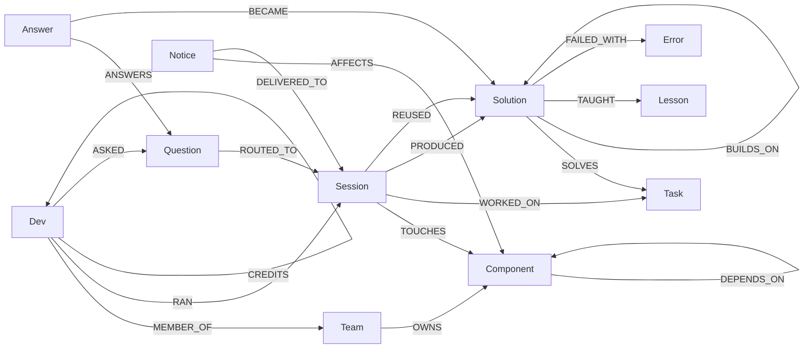
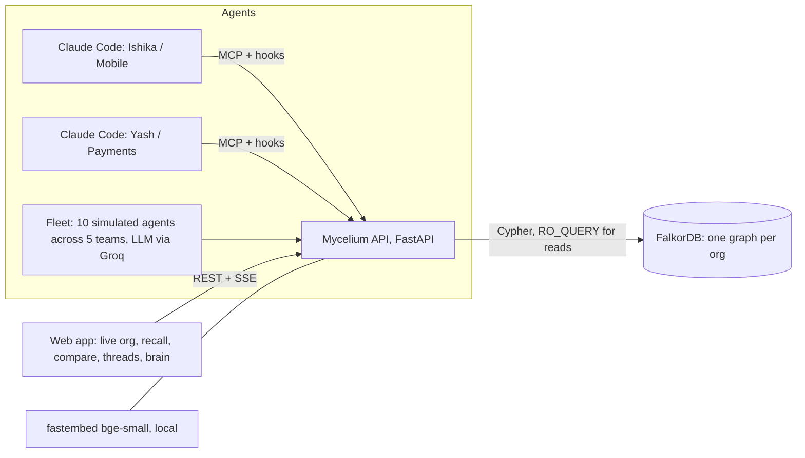

# Mycelium

**One shared context graph for every AI agent in a company, built on [FalkorDB](https://falkordb.com).**

> *In a forest, fungal networks connect separate trees so they can share nutrients and warnings.*

Built for **Graph Hacks: Context for AI Agents** (WeMakeDevs × FalkorDB).
**Tracks:** 02 Agent Memory & Coordination (primary) · 03 Company Brain

**Links:**
- **Live demo (web app):** https://web-production-76872.up.railway.app
- Live API: https://api-production-377ba.up.railway.app/docs
- **Demo video:** https://youtu.be/BLPcN9v1BeE

[](https://youtu.be/BLPcN9v1BeE)
- Blog post: _(link)_

---

## Try it in 2 minutes
- **Overview** (`/`): the problem, our demo company **Graph HQ**, and how Mycelium solves it.
- **Tour** (button in the nav): a guided walkthrough that points at the exact place in the product where each thing happens.
- **Playground** (`/playground`): six Graph HQ engineers whose agents are mid-chat, each about to re-solve something the org already solved. Choose *solve from scratch* (replays what it cost the first time) or *Ask Mycelium first* (watch the memory fetch step by step: vector search → graph walk past stale fixes → context → rank and credit, with the real Cypher), then *Implement this*.
- **Live org** (`/live`): every agent running right now, change ripples and agent-to-agent questions in real time.

## The graph map
One FalkorDB graph per company. The arrows are the relationships Mycelium queries.


- **Session** is one run of one AI agent. It is both memory (what it produced) and presence (what it touches right now).
- **Task** carries a vector embedding, so "similar problems" is a FalkorDB vector-index query. Everything after that is graph traversal.
- Full model, properties and indexes: [`docs/graph-model.md`](docs/graph-model.md). Every query the product runs: [`docs/cypher.md`](docs/cypher.md).

## The graph doing the work
Three things the product does that only the graph can answer, each with the query behind it and what you can watch in the live demo.

**1. Skip a fix that later broke** (Playground → Neha → *Ask Mycelium first*; or Vector vs graph)
```cypher
OPTIONAL MATCH p = (newer:Solution)-[:SUPERSEDES*1..4]->(s0:Solution {id:$id})
```
Vector search returns *"Retry once after refreshing the token on 401"* (similarity 0.89), which failed in production with a 429 refresh storm. The graph walks `SUPERSEDES` to Yash's single-flight fix and attaches the `FAILED_WITH` error and dead-end `Lesson`s. **Vector-only 0/12, Mycelium 12/12.**

**2. Warn exactly the agents a change affects** (Live org → *Announce a change*)
```cypher
MATCH p = (dep:Component)-[:DEPENDS_ON*1..3]->(:Component {name:$c})
MATCH (d:Dev)-[:RAN]->(s:Session {status:'live'})-[:TOUCHES]->(dep)
```
In one run, a change to `token-service` reached Meera (same service), Priya (`auth-gateway`, 1 hop), Tom and Rohan (2 hops) and Neha (`offline-sync`, 3 hops), and no one working on unrelated services. **Precision and recall 1.0** across our benchmark impact cases.

**3. Route a question to whoever knows, right now** (Ask → *Ask a person or agent*)
```cypher
MATCH (d:Dev)-[:RAN]->(s:Session {status:'live'})-[:TOUCHES]->(c:Component {name:cw.name})
CALL algo.pageRank('Dev','CREDITS') YIELD node, score
```
*"Is anyone rotating the token-service signing keys right now?"* goes to Meera's live agent, which is touching `token-service`, with the path shown. **8/8 vs 4/8** for nearest-neighbour routing.

Every API response includes the exact Cypher it ran (the **Show Cypher** panel in the UI).

**Removal test:** with FalkorDB stopped, every endpoint returns `503` (`tests/test_api.py::test_removal_test_db_down_gives_503`). There's no cache and no other store.

## The problem
A company today runs dozens of AI agents: every developer, on every team, across many components. **Each one is an island.**

**Across time, history repeats.**
- Someone spends three days cracking a token-refresh race.
- Two projects later, another team's agent hits the same bug and starts from zero. The human forgot. Nobody updated the docs. Every agent session starts blank.
- The same dead ends are re-explored and the same tokens are burned.

**Across the org, right now, nobody can see anybody else.**
- Teams split by component are solving overlapping problems at the same moment.
- They change interfaces other teams depend on.
- They hold the one piece of context another team's agent is missing.

## What Mycelium does
It gives every agent in the org one shared context graph.

| | |
|---|---|
| **Recall across time and teams** | "Yash on Payments solved this in *Checkout v2*, 10 weeks ago: 3 days of work, 14 attempts. Here's the fix, the 2 dead ends to skip, and ~168k tokens you don't have to spend." |
| **Memory that corrects itself** | Recall follows `SUPERSEDES` past fixes that later **broke**, and warns you about them. A plain vector store hands you the broken one. |
| **Hard-won knowledge ranks first** | Effort (time, attempts, tokens) is part of the ranking. Every reuse credits the author. |
| **Knowledge compounds** | `BUILDS_ON` lineage shows how a fix evolved across projects and teams. |
| **Live awareness** | See which agents are running right now, on which components. Overlapping work across teams is detected and both agents are told. |
| **Agents talk to agents** | `ask_org` answers from memory first. Otherwise the graph routes the question to the agent that is **live on the relevant component right now**, or to the owners or past solvers, and shows the path. The answer becomes memory. |
| **Change propagation** | Announce a change to `token-service`. Mycelium walks `DEPENDS_ON` and warns exactly the live agents whose work depends on it, plus owning team inboxes. |
| **Handoffs** | Unfinished work becomes a node any agent, on any team, can pick up with full context. |
| **Company brain** | Who knows X (PageRank over who credits whom), knowledge at risk (hard fixes only one person has touched), tokens saved per team, help flows between teams. |
| **Works in tools devs already use** | An MCP server (13 tools) plus Claude Code hooks. Memories and inbox messages (questions for you, change notices, overlaps) arrive in the agent's context automatically. |
| **Backfill** | Import existing Claude Code transcripts (with secrets and PII scrubbed), so adoption starts with history. |

## Why it has to be a graph
The questions agents need answered are relationships:
- Who owns this component?
- What depends on it?
- Which live agents are touching its dependents?
- Who solved this before, in which project?
- What broke since, and what replaced it?
- Who credits whom?

Similarity search can find text that *looks* related. Only the graph knows that a fix was superseded, who is live on what, and what depends on what.

## Results (`eval/results.md`, reproducible)
Same embeddings and the same FalkorDB vector index on both sides. The only difference is whether the graph is used.

| Task | Vector-only | Mycelium |
|---|---|---|
| Stale-fix trap: top-1 is the current fix | 0/12 | **12/12** |
| Stale-fix trap: top-1 is a superseded/broken fix | 12/12 | **0/12** |
| Cross-team / cross-project recall @1 | 12/12 | 12/12 |
| Question routing @1 (who should answer *now*) | 4/8 | **8/8** |
| Change impact: precision / recall of warned live agents | see results.md | **1.0 / 1.0** |

- Hybrid recall (vector KNN plus 3 graph queries) takes about **3 ms p50**.
- **50 concurrent agents** running the full agent loop through the API produce **0 errors** at about 210 ops/s (`eval/concurrency.md`).
- Caveats are spelled out in [`eval/results.md`](eval/results.md): we wrote the org and the cases, and there is no held-out set.

## Architecture

- **FalkorDB** is the only store.
  - One graph per org is the tenant boundary.
  - Visitors get a private copy via `GRAPH.COPY`.
  - Native vector indexes on `Task` and `Question` cover the "similar" half.
  - Cypher covers the rest, including `algo.pageRank` and variable-length `DEPENDS_ON` and `SUPERSEDES` walks.
  - Live events reach the UI over SSE from the API's in-process bus. All agents go through the API. FalkorDB Cloud free doesn't allow pub/sub.
- **The LLM never writes Cypher.** Agents call a fixed catalogue of parameterised tools. Names are resolved against the graph, so agents can't invent components or people. Writes pass a code-level gate that leaves receipts.

The full graph model is in [`docs/graph-model.md`](docs/graph-model.md), and every query the product runs is in [`docs/cypher.md`](docs/cypher.md).

### Graph model (short)
```
(:Team)-[:OWNS]->(:Component)-[:DEPENDS_ON]->(:Component)      (:Dev)-[:MEMBER_OF]->(:Team)
(:Dev)-[:RAN]->(:Session {status: live|done})-[:TOUCHES]->(:Component)
(:Session)-[:WORKED_ON]->(:Task {embedding})<-[:SOLVES]-(:Solution {status, visibility, effort})
(:Solution)-[:SUPERSEDES|BUILDS_ON]->(:Solution)    (:Solution)-[:TAUGHT]->(:Lesson {pitfall|tip|dead_end})
(:Session)-[:REUSED {tokens_saved}]->(:Solution)    (:Dev)-[:CREDITS]->(:Dev)           // PageRank
(:Dev)-[:ASKED]->(:Question)-[:ROUTED_TO]->(:Session)   (:Answer)-[:BECAME]->(:Solution)
(:Notice)-[:AFFECTS]->(:Component)   (:Notice)-[:DELIVERED_TO]->(:Session)   (:Session)-[:OVERLAPS]->(:Session)
```

## Deployment
- **Database:** FalkorDB Cloud, free tier, AWS ap-south-1, plain RESP with a client `socket_timeout` (TLS hangs on the free tier).
- **API and fleet:** Railway (Singapore, nearest region to the database), one Docker image with two roles (`MYC_ROLE=fleet`).
- **Web:** Next.js 16, also on Railway (Singapore).

The public demo org is read-only for visitors' agent writes. `POST /api/sandbox` gives every visitor a private writable copy.

## Run it locally
Requirements: Docker, [uv](https://docs.astral.sh/uv/), Node 20+ (for the web app).
```bash
git clone https://github.com/ishikatyagi-star/mycelium && cd mycelium
docker compose up -d                               # FalkorDB v4.22.1 (pinned) + Browser on http://localhost:3000
uv sync
PYTHONPATH=. uv run python -m seed.graphhq            # synthetic org "graphhq": 5 teams, 17 components, 14 devs, ~70 sessions
PYTHONPATH=. uv run uvicorn api.main:app --port 8000
PYTHONPATH=. uv run python -m fleet.run --hold     # optional: 10 live simulated agents (LLM_API_KEY in .env: Groq or xAI key)
cd web && npm install && npm run dev               # http://localhost:3001 (see web/README)
```
Tests (against a real FalkorDB) and the benchmarks:
```bash
uv run pytest -q
PYTHONPATH=. uv run python -m eval.benchmark       # writes eval/results.md
PYTHONPATH=. uv run python -m fleet.load           # writes eval/concurrency.md
```

### Onboard your own company (one API call)
Describe your teams, the services they own, how the services depend on each other, and who's on which team. Mycelium creates a new graph (`org_<slug>`) and your agents can use it right away.
```bash
curl -X POST https://api-production-377ba.up.railway.app/api/orgs -H 'content-type: application/json' -d '{
  "slug": "acmecorp",
  "teams": [
    {"name": "Core", "services": [{"name": "api"}, {"name": "db", "category": "infra"}],
     "people": [{"name": "Asha", "role": "backend"}, {"name": "Ben"}]},
    {"name": "Apps", "services": [{"name": "web"}], "people": [{"name": "Chen"}]}
  ],
  "dependencies": [{"service": "web", "depends_on": "api"}, {"service": "api", "depends_on": "db"}],
  "projects": [{"name": "Launch", "services": ["web", "api"]}]
}'
```
- **`201`** returns the new org's overview, plus the next calls to make (start a session, recall, ask, connect Claude Code).
- **`409`** means the slug is taken.
- **`422`** lists *every* problem in the spec at once (unknown services in dependencies, a person on two teams, a service owned twice). Nothing is written until the whole spec is valid.
- **Then:** `POST /api/orgs/acmecorp/sessions` with `{"dev": "Chen", "task": "..."}`, or connect Claude Code: `scripts/install_claude.sh <project_dir> Chen acmecorp https://api-production-377ba.up.railway.app`.

### Connect your own Claude Code
```bash
scripts/install_claude.sh /path/to/your/project <YourName> graphhq http://localhost:8000 "Mobile 3.0"
```
This writes `.mcp.json` (the `mycelium` MCP server) and `.claude/settings.local.json` (the hooks) into your project. Open Claude Code there and just work:
- Your first prompt registers a live session.
- Relevant org memories and overlapping live work are injected into context.
- Questions routed to you and change notices show up as you go.
- At the end, the agent is nudged to save what it learned.

| MCP tool | What it does |
|---|---|
| `recall` | Org memory for a problem. Skips stale fixes; includes dead ends, effort and credit |
| `ask_org` | Answer from memory, or route to the best live agent or person (with the reason) |
| `check_inbox` / `answer_question` | Questions routed to you, notices, overlaps, handoffs; answer and your answer becomes memory |
| `save_solution` / `report_outcome` | Write memory (through the gate); credit or flag what you reused |
| `announce_change` | Warn every live agent whose work depends on a component |
| `handoff` / `pick_up_handoff` | Pass unfinished work across agents and teams |
| `touch_components`, `live_agents`, `who_knows`, `lineage` | Presence, the live org, expertise, knowledge evolution |

### Backfill from transcripts (and our dogfood org)
The live API also serves a second org, `mycelium`: our real team, with memory imported from the Claude Code sessions in which we built Mycelium.
1. Secrets, emails, hosts and home paths are scrubbed.
2. An LLM proposes memories.
3. We curate them.
4. The write gate stores them.

See `seed/mycelium_team.py` and `seed/dogfood_memories.json`.
```bash
PYTHONPATH=. uv run python -m core.importer ~/.claude/projects/<project>/<session>.jsonl --org graphhq --dev Ishika --project "Mobile 3.0"
```

## Repo layout
| Path | |
|---|---|
| `core/` | Graph logic: `memory.py` (sessions, gate, hybrid recall, lineage), `presence.py`, `messaging.py` (ask/route/answer, notices, handoffs), `brain.py`, `importer.py`, `db.py` (RO queries plus per-request Cypher trace) |
| `api/` | FastAPI: REST, SSE, sandbox orgs, rate limit, read-only public demo |
| `mcp_server/` | MCP server (13 tools) plus a shared HTTP client |
| `hooks/` | Claude Code hooks (SessionStart, UserPromptSubmit, PostToolUse, Stop, SessionEnd) |
| `fleet/` | Simulated agents (`run.py`) and a concurrency load test (`load.py`) |
| `seed/` | Synthetic org with planted stories |
| `eval/` | Vector-only vs graph benchmark plus results |
| `web/` | Next.js app: live org, recall, compare, threads, company brain |
| `docs/` | Graph model, Cypher, API contract, AI disclosure, [FalkorDB notes](docs/falkordb-notes.md), [demo script](docs/demo-script.md) |

## Honest limits
- **The data is synthetic** (Rule 6). The planted stories make the mechanisms visible; real orgs are messier.
- **Identity is trusted:** `MYC_DEV` is configuration, not authentication, and any org created through `POST /api/orgs` is writable by anyone who knows its slug. Real deployments need SSO and per-org keys.
- **Routing is a weighted heuristic** (live-on-component > past solver > owner, times PageRank), tuned on our own org.
- **Embeddings are local and small** (bge-small) for zero-cost setup. Swapping models is a one-line change.
- **FalkorDB versions:** the live demo runs on **FalkorDB Cloud** (free tier, v4.22.0). Locally we pin the Docker image to v4.22.1 (`:latest` on 2026-10-15). The full test suite passes on both. We haven't run it on the 6.0 Rust engine (`edge-rs`) yet.

## AI disclosure
We built this with Claude Code, and an LLM (Groq, `gpt-oss-120b`) runs inside the product for fleet answers, transcript extraction and the playground's *Implement this*. Details are in [`docs/ai-disclosure.md`](docs/ai-disclosure.md).

## Team
Ishika Tyagi · Yash
