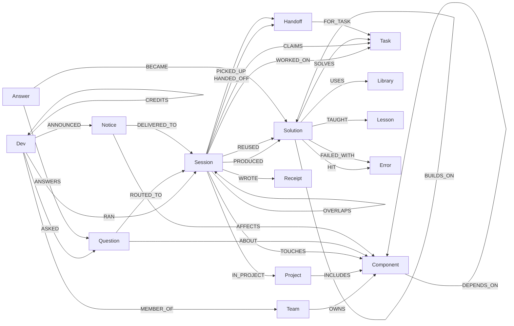

# Graph model

One FalkorDB graph per organisation (`org_<slug>`). The graph is the tenant boundary: an agent in `org_acme`
cannot see anything in another org's graph. The public demo hands every visitor a private copy
(`GRAPH.COPY org_acme org_sandbox_xxxx`).

## Nodes
| Label | Key properties | Meaning |
|---|---|---|
| `Team` | name | An owning team (Identity, Payments, ...) |
| `Component` | name, category | A service, worker, client or library that a team owns |
| `Dev` | name, role | A person. Their agents' sessions hang off them |
| `Project` | name, repo, started_at | A body of work spanning components (and time) |
| `Session` | id, agent, status (`live`/`done`), started_at, last_seen, ended_at, attempts, tokens, task | One run of one agent: the unit of **episodic** memory and of **presence** |
| `Task` | id, text, `embedding` (vecf32, 384-d) | A canonical problem. Near-identical problems (cosine ≥ 0.93) merge into one Task |
| `Solution` | id, title, summary, code, status (`active`/`broken`/`superseded`), visibility (`private`/`team`/`org`), effort_minutes, attempts, tokens_spent | **Procedural** memory: how a problem was solved, and what it cost |
| `Lesson` | text, kind (`pitfall`/`tip`/`dead_end`) | **Semantic** memory distilled from solutions. Dead ends are first-class |
| `Error` | signature | An error seen on the way (`HIT`) or a failure of a solution (`FAILED_WITH`) |
| `Library` | name | Dependency used (`USES {version}`) |
| `Question` | id, text, `embedding`, status (`open`/`routed`/`answered`), mode | A question one agent asked the org |
| `Answer` | id, text | An agent's answer; it `BECAME` a Solution so the org never has to ask again |
| `Notice` | id, kind, text | A change announcement (interface/schema/config) on a component |
| `Handoff` | id, notes, status | Unfinished work any agent can pick up |
| `Receipt` | decision (`ACCEPT`/`REJECT`), reasons | Write-gate audit trail for every attempted write |

## Why each relationship matters (what a vector store cannot do)
| Question the agent needs answered | Relationship(s) that answer it |
|---|---|
| "Has anyone solved this before?" | vector KNN on `Task` → `SOLVES` ← `Solution` |
| "...and is that fix still good?" | `SUPERSEDES*`, `FAILED_WITH` |
| "...and what did they try that didn't work?" | `TAUGHT` → `Lesson {kind:'dead_end'}` |
| "Who solved it, in which project, how hard was it?" | `PRODUCED` ← `Session` ← `RAN` ← `Dev`, `IN_PROJECT`, effort properties |
| "Am I allowed to see it?" | `visibility` + `MEMBER_OF` (private / team / org) |
| "Is anyone working on something similar right now?" | live `Session` → `WORKED_ON` → similar `Task` → `OVERLAPS` |
| "Who should I ask?" | `Component` ← `TOUCHES` ← live `Session`; `Team` → `OWNS`; past solvers; PageRank over `CREDITS` |
| "Who breaks if I change this?" | `DEPENDS_ON*1..3` ← dependents ← `TOUCHES` ← live sessions |
| "How did this knowledge evolve?" | `BUILDS_ON*` / `SUPERSEDES*` across projects and teams |
| "What knowledge would we lose if X left?" | high-effort `Solution`s with no `REUSED` from anyone else |

## Indexes
- Vector: `Task(embedding)`, `Question(embedding)`, with cosine similarity, 384 dimensions (`BAAI/bge-small-en-v1.5`, computed locally with fastembed).
- Range: names and ids on every label used for lookups (`core/schema.py`).

## Write path (the gate)
Agents and LLMs **propose** memory. Plain code (`core/memory.py::gate`) **decides** whether it gets stored:
- It validates lengths, visibility and lesson kinds.
- It resolves referenced solutions and components against the graph. Unknown names are dropped, so nothing can be invented.
- It merges near-duplicate tasks.
- It writes a `Receipt` for every accept or reject.

All reads go through `GRAPH.RO_QUERY`.
